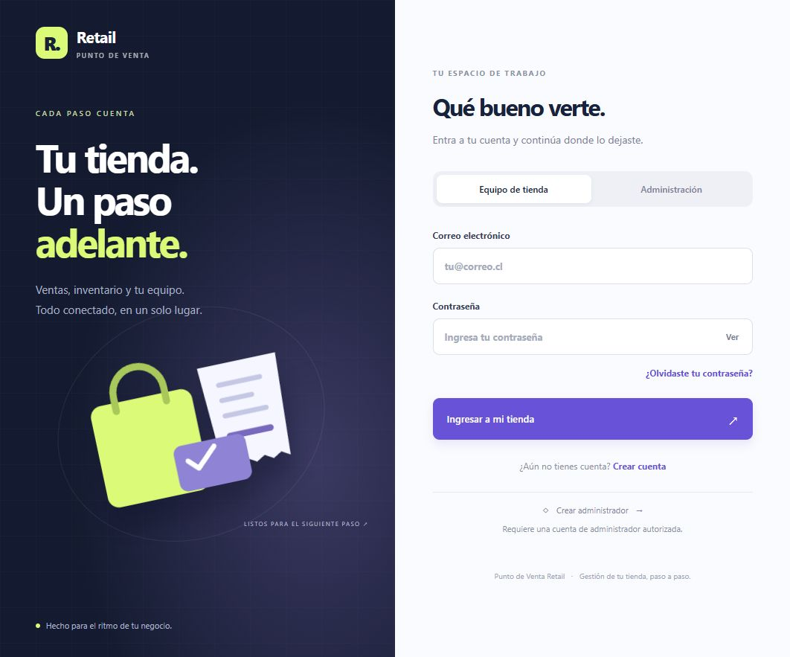

# WebRetail — Punto de Venta Retail

Sistema de ventas e inventario para tiendas, con control de stock, pagos combinados y cuadratura diaria de caja.

**C# · .NET 11 · ASP.NET Core MVC · EF Core · SQL Server · Identity**



> Proyecto de portafolio. Boletas, facturas y notas son documentos simulados, sin validez tributaria ni integración con el SII. Los pagos se registran manualmente.

## Qué resuelve

- **Ventas:** carrito por SKU, ofertas por marca/talla/producto y pagos combinados.
- **Caja:** cantidad y monto de boletas/facturas, ingresos por medio de pago y diferencias frente al conteo del cajero.
- **Inventario:** compras, costos, bodegas, traspasos y conteos físicos.
- **Posventa:** devoluciones y cambios de talla/color con ajuste de stock y dinero.
- **Administración:** usuarios por rol, auditoría, reportes Excel y respaldos SQL.

## Decisiones técnicas

| Problema | Solución |
| --- | --- |
| Dos ventas compiten por el mismo stock | Operaciones transaccionales y control de concurrencia. |
| Se reintenta una venta o un cobro | Confirmación idempotente para evitar duplicados. |
| Un cambio de talla falla a mitad del proceso | Devolución y nueva entrega en una operación atómica. |
| El dinero contado difiere de las ventas | Comparación por medio de pago, ajuste del fondo/retiros y observación de diferencias. |

## Ejecutar localmente

Requisitos: SDK **11.0.100**, SQL Server local con autenticación Windows y certificado HTTPS de desarrollo. No requiere npm.

```powershell
git clone https://github.com/eduardoaraneda/WebRetail.git
cd WebRetail
$env:ASPNETCORE_ENVIRONMENT = "Development"
$env:ConnectionStrings__Tienda = "Server=localhost;Database=RetailPOS;Integrated Security=True;Encrypt=True;TrustServerCertificate=True;Connect Timeout=10"
dotnet tool restore
dotnet restore RetailPOS.slnx
dotnet build RetailPOS.slnx
dotnet run --project src/RetailPOS.Web -- --crear-base
dotnet run --project src/RetailPOS.Web --launch-profile https
```

Abre **https://localhost:7243** y crea el administrador inicial. Esta opción está disponible solo en desarrollo local y cuando todavía no existen usuarios. Usa credenciales propias.

La solución se llama `RetailPOS.slnx`. La configuración histórica apunta a `ZapatillasPOS`; el ejemplo anterior selecciona explícitamente una instalación nueva `RetailPOS`. El comando de migración admite ambos nombres.

## Verificación

```powershell
dotnet run --project tests/RetailPOS.Verificacion
```

El ejecutable de verificación requiere SQL Server y crea bases aisladas. Comprueba concurrencia, pagos, devoluciones, permisos y cuadraturas, entre otros flujos. Las pruebas de respaldo requieren permisos de backup/restore. Consulta los requisitos completos antes de ejecutarlo en [la guía de operación](docs/operacion.md#pruebas).

El workflow de GitHub Actions restaura y compila la solución. La compilación automática no sustituye las verificaciones de integración con SQL Server.

## Arquitectura

```text
src/
  RetailPOS.Domain/          Entidades y reglas
  RetailPOS.Application/     Contratos y solicitudes
  RetailPOS.Infrastructure/  EF Core, Identity y operaciones transaccionales
  RetailPOS.Web/             MVC, Razor y permisos
tests/                      Verificación de integración
database/                   Scripts SQL
docs/                       Guías funcionales y operativas
```

## Documentación

- [Módulos, recorrido de uso y operación](docs/operacion.md)
- [Cuadratura diaria](docs/cuadratura-diaria.md)
- [Despliegue y recuperación](docs/despliegue-y-recuperacion.md)
- [Acceso e interfaz](docs/interfaz-y-acceso.md)

## Autor

[Eduardo Araneda](https://github.com/eduardoaraneda) · [Portafolio](https://eduardoaraneda.github.io/Portafolio/)
